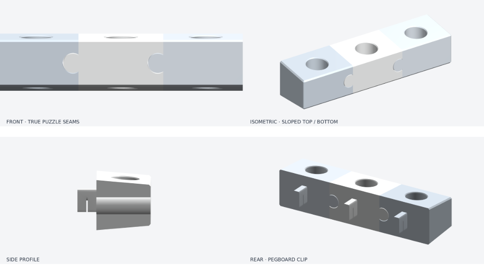
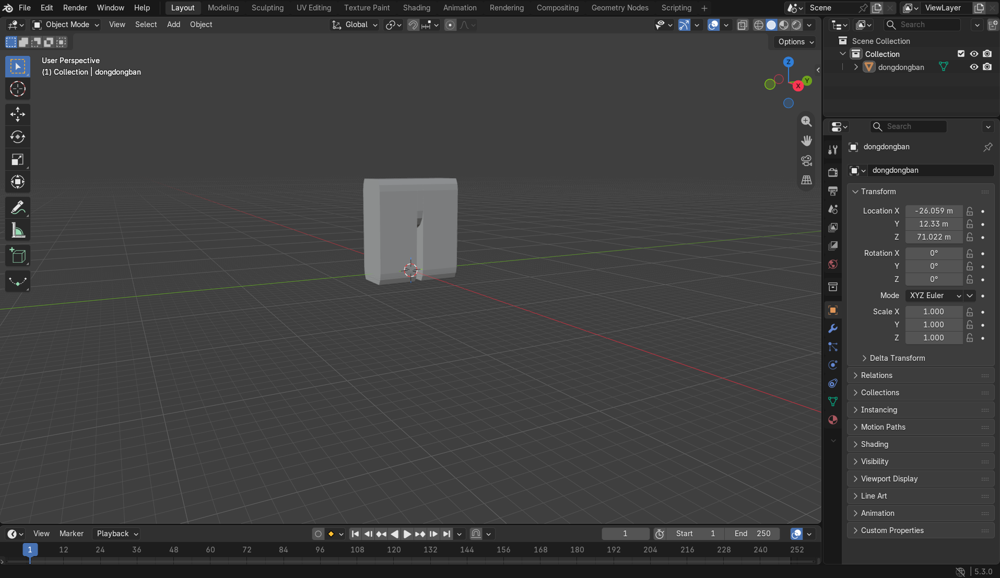
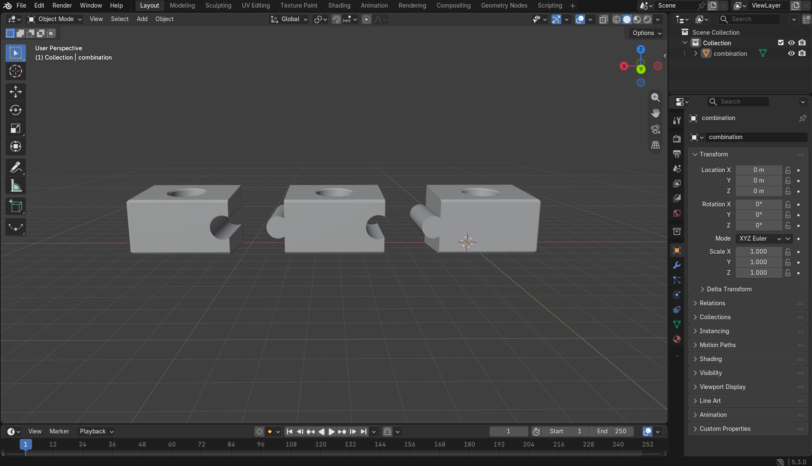
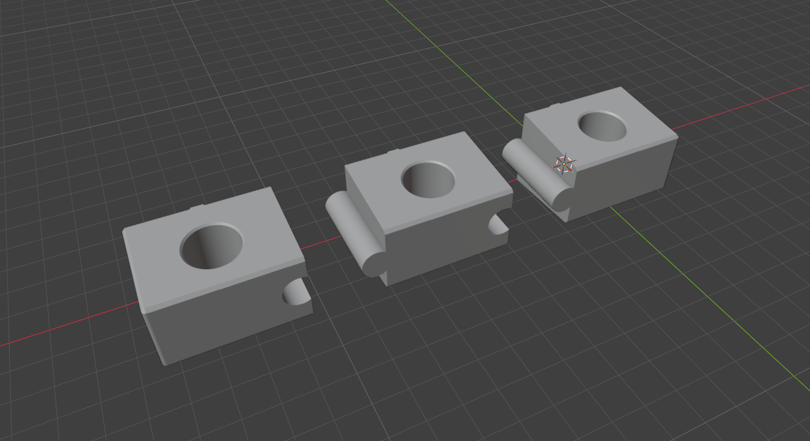
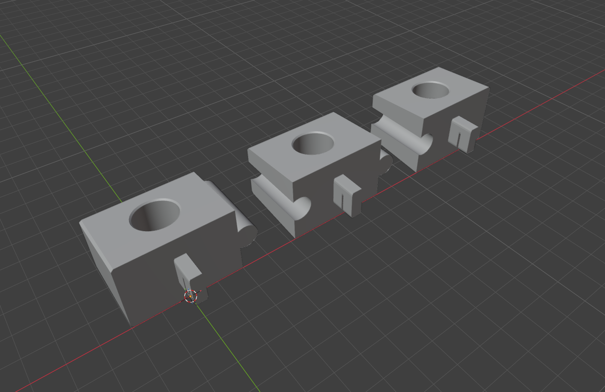
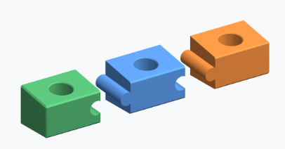
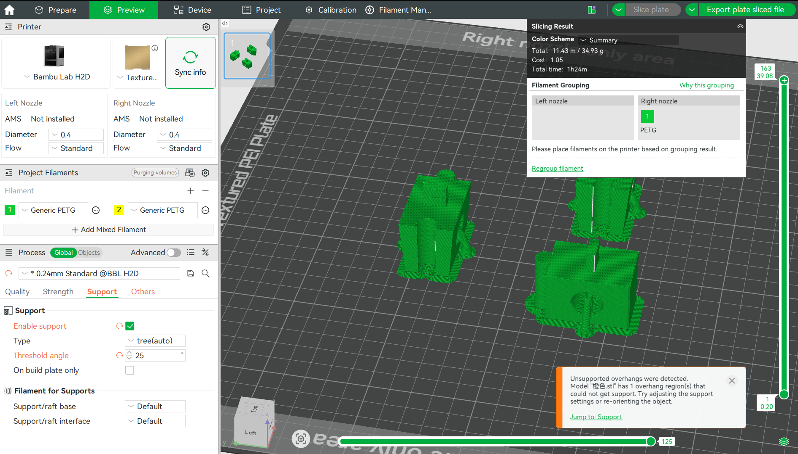
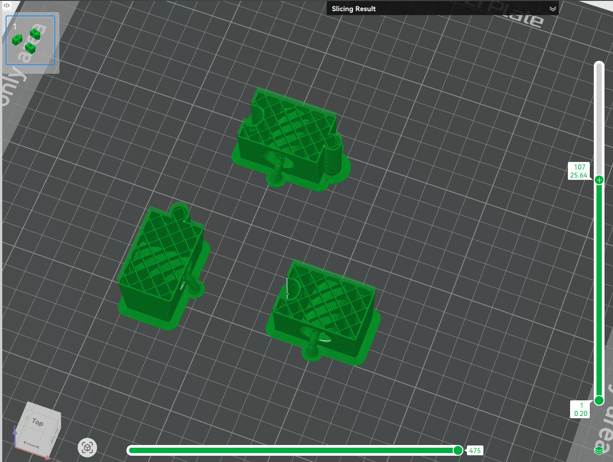
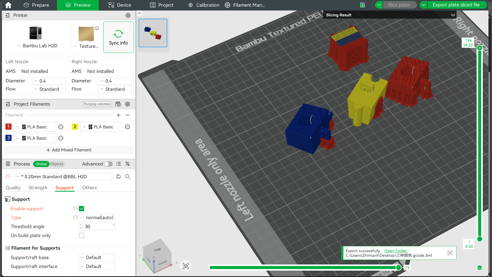
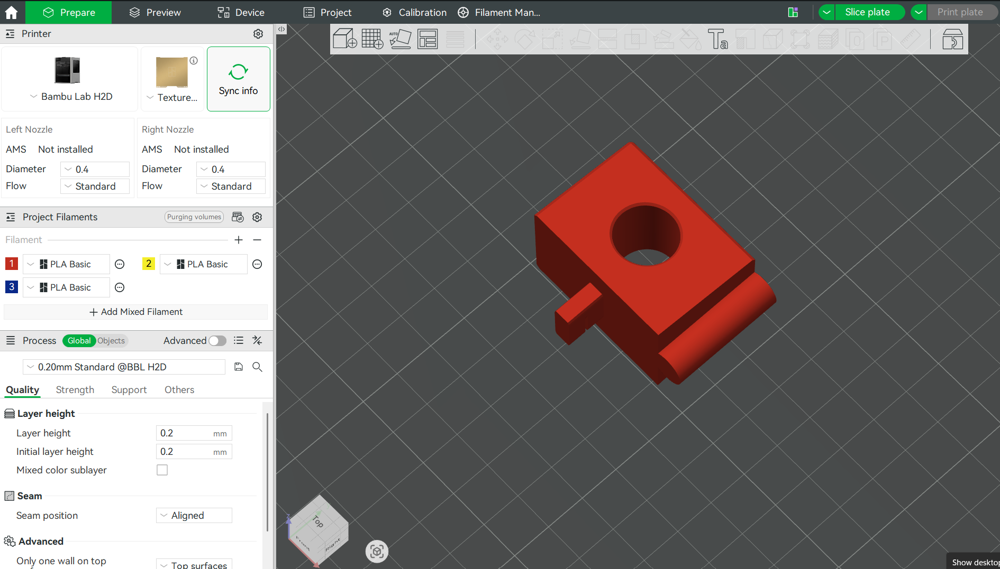

# Modular Puzzle Pegboard Screwdriver Holder

## 1. What is it?

This project is a modular, 3D-printed screwdriver holder designed for a laboratory pegboard. It consists of three puzzle-shaped pieces: a left module, a middle module, and a right module. The pieces fit together to form one holder, but they can also be printed separately in three different colors.

## 2. What does it do?

Each module holds one screwdriver through an approximately 15 mm circular opening. The three-piece design helps organize frequently used screwdrivers on the pegboard while allowing the modules to be combined or separated. The mounting interface is based on the pegboard hook supplied by the instructor.

## Pegboard Slot Dimensions

The holder was designed for the laboratory pegboard using the dimensions shown in the supplied reference diagram. Its mounting slots are **rounded vertical openings** arranged in staggered rows.

| Pegboard measurement | Reference dimension |
| --- | ---: |
| Slot width (short dimension) | **5 mm** |
| Slot length (long dimension) | **15 mm** |
| Horizontal center-to-center distance between slots in the same row | **40 mm** |
| Clear horizontal gap between adjacent slots in the same row | **35 mm** |
| Clear vertical gap between vertically aligned slots | **25 mm** |

The 40 mm horizontal pitch is especially important for positioning the three modules consistently on the pegboard. The design uses the **pegboard hook STL originally provided by the instructor** as its reference mounting interface, rather than creating an unrelated attachment shape. In this project, the approximately **15 mm circular screwdriver openings** are separate from the pegboard's **5 × 15 mm mounting slots**.

## 3. How was it made?

1. **Brainstorming:** I identified the need for a screwdriver organizer that fits the workshop pegboard, and developed a modular, puzzle-shaped concept.
2. **Reference geometry:** I imported the instructor-provided pegboard hook STL into **Blender** as the starting mounting interface.
3. **Modeling:** I developed three interlocking pieces (left, middle, right), each with an approximately **15 mm screwdriver opening**, while retaining the reference pegboard hooks.
4. **Export:** I exported individual and three-part designs in **STL** and **STEP** formats.
5. **Slicing:** I prepared the designs in **Bambu Studio**, including separate print jobs and a combined layout, for the **Bambu Lab H2D** with a **0.4 mm nozzle**.
6. **Initial printing:** I chose an orientation with the hook side facing upward, prioritizing **fewer support structures**. During printing/handling, **one hook broke**.
7. **Feedback and revision plan:** My instructor explained that, for FDM printing, the hook orientation relative to the printed layers matters. The next iteration will **rotate the model so the hooks face sideways rather than upward**, even if this requires more supports. This revised orientation still needs to be printed and tested.

## 4. Design and Fabrication Documentation

All images below are screenshots and design images from this project. They are displayed directly in the README at readable sizes. The ideal-outcome images are **design visualizations, not photographs of a successfully printed product**.

### 4.1 Design Concept

*Figure 1. Design proposal and model overview.*

### 4.2 Reference Pegboard Hook and Blender Modeling

The pegboard hook was based on the instructor-provided STL.

*Figure 2. Reference hook geometry imported into Blender.*

*Figure 3. Three-piece modular design in Blender.*

*Figure 4. Additional view of the modular holder in Blender.*

*Figure 5. Mounting interface and additional modeling details.*

### 4.3 Intended Appearance

*Figure 6. Intended three-color design, isometric view.*

*Figure 7. Intended appearance from the front.*

### 4.4 Slicing in Bambu Studio

The screenshots below document the preparation and slicing stages. The initial setup favored reducing supports, but the print revealed a weakness at the hook; see Section 5.

*Figure 8. Slicing process — screenshot 1.*

*Figure 9. Slicing process — screenshot 2.*

*Figure 10. Slicing process — screenshot 3.*

*Figure 11. Slicing process — screenshot 4.*

## 5. First Print: Problem and Planned Improvement

### What happened

In the first print, the side carrying the pegboard hooks was oriented **upward**. I originally chose this arrangement to **minimize support material** and simplify printing. However, **one hook broke**, showing that reducing supports alone was not enough to produce a robust attachment.

### What I learned

In **FDM printing**, parts are built layer by layer, and strength often differs along the layer lines versus across the bonds between layers. A slender hook may fail if its geometry and expected bending loads are poorly aligned with the print layers. My instructor recommended changing the print orientation so **the hooks face sideways** instead of upward.

### Next iteration

- Rotate the models in the slicer so the **hooks are oriented sideways**.
- Recheck supports and overhangs, accepting additional supports if needed for a stronger part.
- Print again, remove supports carefully, and test whether the hooks withstand pegboard mounting and normal handling.
- Add real photographs of the completed physical parts and installation results **after** the reprint and test.

**Current status:** The initial print exposed a broken hook. The proposed orientation change is **not yet documented here as a successful, tested print**.

## 6. Model and Sliced Print Files

The `models/` directory contains **4 STL models, 4 STEP models, and 4 sliced `.gcode.3mf` print-job files**. Select a file to view or download it directly from GitHub.

| Part | STL — model mesh | STEP — CAD geometry | G-code 3MF — sliced job |
| --- | --- | --- | --- |
| Left module | [Left STL](models/puzzle_pegboard_left.stl) | [Left STEP](models/puzzle_pegboard_left.step) | [Left sliced job](models/puzzle_pegboard_left.gcode.3mf) |
| Middle module | [Middle STL](models/puzzle_pegboard_middle.stl) | [Middle STEP](models/puzzle_pegboard_middle.step) | [Middle sliced job](models/puzzle_pegboard_middle.gcode.3mf) |
| Right module | [Right STL](models/puzzle_pegboard_right.stl) | [Right STEP](models/puzzle_pegboard_right.step) | [Right sliced job](models/puzzle_pegboard_right.gcode.3mf) |
| Three-part layout | [Layout STL](models/puzzle_pegboard_assembled.stl) | [Layout STEP](models/puzzle_pegboard_assembled.step) | [Combined sliced job](models/puzzle_pegboard_assembled.gcode.3mf) |

The assembled files retain the three parts as **separate pieces** rather than joining them into a single solid. A `.gcode.3mf` file is a **sliced 3MF container** that includes machine instructions and print settings; it is not an editable CAD model.

**Important:** These sliced jobs document the print preparation. Check and update the **hook orientation, supports, printer, and filament settings** before attempting another print; the existence of a sliced file does not mean the orientation revision has already been tested.
